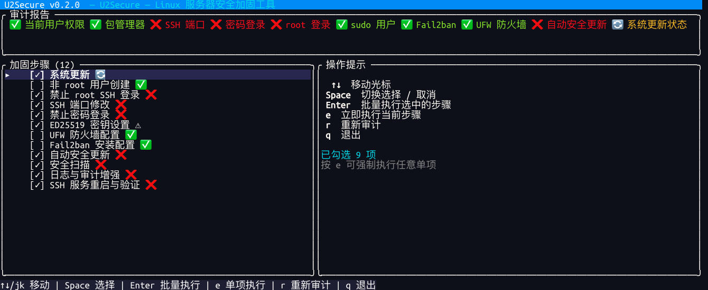
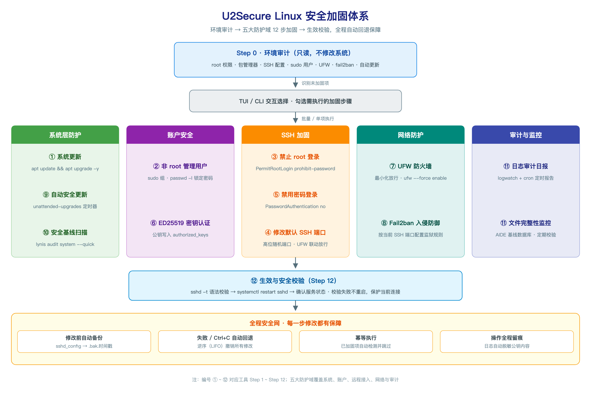

<div align="center">

<h1>U2Secure</h1>
<h3>Linux 服务器安全加固工具 — CLI / TUI 与只读审计</h3>
<p>
  <a href="https://github.com/cherish-ltt/u2secure/actions/workflows/rust-ci.yml">
    
  </a>
  <a href="https://crates.io/crates/u2secure">
    
  </a>
  <a href="https://docs.rs/u2secure">
    
  </a>
  <a href="https://github.com/cherish-ltt/u2secure/blob/main/LICENSE">
    
  </a>
  <a href="https://www.rust-lang.org">
    
  </a>
  
</p>
</div>

> 面向 Linux 运维人员的安全加固工具。支持 **TUI 终端图形界面**与**传统 CLI** 交互式加固，以及独立的 **`audit` 只读报告**。加固流程涵盖系统更新、用户创建、SSH、防火墙、入侵防御、审计与自动更新。

## 目录

- [概述](#概述)
- [安全加固体系](#安全加固体系)
- [快速开始](#快速开始)
- [启动模式](#启动模式)
- [只读审计报告](#只读审计报告)
- [TUI 界面](#tui-界面)
- [功能详解](#功能详解)
  - [Step 0：环境审计](#step-0环境审计)
  - [Step 1 ~ Step 12：加固步骤](#step-1--step-12加固步骤)
- [安全回退机制](#安全回退机制)
- [常见问题](#常见问题)
- [贡献指南](#贡献指南)
- [版本历史](#版本历史)

---

## 概述

### 设计目标

- 首次运行自动审计系统当前安全状态，对已加固项目标记"安全可靠"（**幂等**）
- **TUI 模式**：ratatui 终端图形界面，步骤列表 + 日志面板 + 进度条，支持单项强制执行
- **CLI 模式**：传统 dialoguer 向导式交互，兼容原版体验
- **只读审计**：`audit` 无需 TTY，输出文本或稳定 JSON，不创建操作日志或报告文件
- 每步执行前检测状态，不重复配置
- 同批次创建用户与设置密钥时，同一用户只生成一次密钥，执行器会明确报告跳过重复生成。
- 支持自动备份与回退；SSH 生效尝试是整批提交边界，其后失败或中断保留修改并要求人工检查
- 新用户创建成功即纳入回退，后续加组、目录权限或密钥初始化失败不会遗漏该账户的撤销。
- 公钥追加使用账户数据库中的 home，并拒绝符号链接、硬链接、非普通目标或不安全的目录归属/权限；现有密钥不会被覆盖。
- 生成密钥先在私有临时目录完成；TUI 确认覆盖后由步骤保存旧文件，失败或取消回退时恢复原字节与权限，恢复失败会保留备份并报告路径。

### 适用范围

APT 索引刷新使用严格错误模式：任一索引失败均返回失败，不把旧缓存当作此次刷新成功。
镜像预热失败仍按约定尝试三次，再交由用户重试、更换源或取消。

长耗时命令在独立进程组中运行；超时、取消或无输出时终止整组并回收直接子进程，
正常主进程退出也清理仍留在组内的后台任务。主动脱离进程组的守护进程不在此保证范围内；
这不是容器级隔离，也不保证立即撤销内核中已提交的不可中断 I/O。

npm 安装仅在下载完整且落盘成功后替换本地二进制；下载或写入失败会非零退出，并保留已有完整文件。
维护者可用 `node tests/npm_install_test.cjs` 运行不联网、不执行下载产物的回归测试。
手动 Binary Build 输入的标签通过绑定该次运行的 artifact 传给 npm/crates.io；
两个发布器都检出该标签，缺失或非法时不发布。旧构建运行使用手动补发入口。
`python3 tests/release_tag_test.py` 验证标签传递，不触发真实发布。
crates.io Trusted Publishing 不支持 `workflow_run`，当前 crates.io 自动路径不可用；
维护者确认 Binary Build 成功且该版本矩阵中的 Linux 资产齐全后，须手动派发 `cargo-publish.yml`。
npm 仍在 Binary Build 成功后自动发布，具体命令及升级兼容说明见 [v0.6.0](docs/versions/v0.6.0.md)。

| 项目 | 支持情况 |
|------|---------|
| 发行版 | Debian/Ubuntu（首选），兼容 RHEL/CentOS（yum/dnf） |
| 权限 | **必须以 root 运行**；独立 `audit` 不落盘，交互式加固会写操作日志 |
| 内核 | Linux 3.10+ |
| SSH 服务 | OpenSSH（sshd） |
| 防火墙 | UFW（首选），检测到 firewalld 时提示适配 |

### 项目结构

```
src/
├── main.rs                 # 入口：audit / CLI / TUI / 交互选择
├── domain/                 # 领域层（零外部依赖）
│   ├── audit.rs            # AuditReport（全项目唯一状态真值）、AuditStatus、PackageManager
│   ├── steps.rs            # StepKind、HardeningStep trait、ExecuteParams、StepResult/StepOutcome
│   ├── mirror.rs           # PackageMirror（临时软件源值对象）
│   ├── errors.rs           # DomainError
│   └── undo.rs             # UndoAction（可撤销操作值对象）
├── application/            # 应用层
│   ├── orchestrator.rs     # HardeningOrchestrator（审计与依赖装配）
│   ├── job.rs              # StepRunner：统一执行策略 + 后台线程 + 事件流
│   └── steps.rs            # 12 个步骤的具体实现
├── infrastructure/         # 基础设施
│   ├── system.rs           # 系统命令、流式执行（超时/取消）、配置解析、用户与密钥管理
│   ├── audit.rs            # 共用只读探测，区分正常发现与采集失败
│   ├── capture.rs          # 命令输出内存采集（限时、限量、进程组清理）
│   ├── artifacts.rs        # 报告目录（扫描产物持久化）
│   ├── package_mirror.rs   # 临时软件源：主机改写 / 延迟探测 / apt -o 覆盖
│   ├── lynis.rs            # lynis-report.dat 解析
│   ├── aide.rs             # aide 配置探测/兜底生成、数据库初始化与验证
│   ├── logger.rs           # 日志记录（含公钥脱敏）
│   └── rollback.rs         # 回退管理器：undo 栈 + Ctrl+C 信号处理
└── presentation/           # 表示层
    ├── audit.rs            # 独立 text / JSON 审计报告
    ├── cli.rs              # dialoguer 交互式 CLI
    └── tui.rs              # ratatui 终端图形界面（TUI）
```

---

## 安全加固体系

U2Secure 通过**环境审计 → 五大防护域 12 步加固 → 生效校验**的完整流程提升 Linux 服务器的安全基线，提供自动备份、SSH 生效边界前的回退、幂等执行与日志脱敏：



---

## 快速开始

### 安装

> **推荐使用 npm / bun 或 cargo-binstall 安装**：自动根据当前架构（Linux x86_64 / ARM64）下载预编译二进制，无需本地 Rust 环境。
>
> **仅支持 Linux**：U2Secure 依赖 apt/dnf、ufw、sshd、systemd 与 `/var/log` 等 Linux 专有组件，
> 只发布 Linux 二进制；在 macOS/Windows 上请通过 Docker 或 Linux 服务器/虚拟机使用。

后续 Binary Build 在原有 GNU 目标外增加 musl，共生成以下四个 Release 资产；
已发布的 v0.5.0 仍只有 GNU 资产，本次 CI 更新不自动补发或改写该版本：

| 架构 | GNU 资产 | musl 资产 |
|------|----------|-----------|
| x86_64 | `u2secure-x86_64-unknown-linux-gnu` | `u2secure-x86_64-unknown-linux-musl` |
| ARM64 | `u2secure-aarch64-unknown-linux-gnu` | `u2secure-aarch64-unknown-linux-musl` |

npm / bun 安装器仍选择 GNU 资产，不自动识别 musl；musl 产物通过 Release 下载或
cargo-binstall 的对应目标安装。提供 musl 二进制不代表新增 Alpine/OpenRC 加固支持，
运行仍依赖受支持的包管理器、systemd、OpenSSH 和 UFW 等组件。

#### 方式一：npm / bun（推荐）

```bash
# npm 全局安装
npm install -g @ghyper9023/u2secure

# 或 bun 全局安装
bun install -g @ghyper9023/u2secure
```

安装时 postinstall 脚本自动从 GitHub Releases 下载当前平台的预编译二进制，完成后直接运行 `sudo u2secure`。bun 默认拦截 postinstall 脚本，首次安装时按提示信任该包即可。

#### 方式二：cargo-binstall

```bash
cargo binstall u2secure
```

通过 [cargo-binstall](https://github.com/cargo-bins/cargo-binstall) 直接安装 GitHub Releases 中的预编译二进制，跳过本地编译。

#### 方式三：crates.io 源码安装

```bash
cargo install u2secure --locked
```

#### 方式四：从源码编译

```bash
git clone <repo-url> u2secure
cd u2secure
cargo build --release

# 二进制位于 target/release/u2secure
sudo cp target/release/u2secure /usr/local/bin/
```

### 运行

```bash
sudo u2secure           # 交互式选择启动模式
sudo u2secure -t        # 直接启动 TUI 模式（推荐）
sudo u2secure -c        # 直接启动 CLI 模式
sudo u2secure audit     # 仅输出只读审计报告
```

## 启动模式

| 命令 | 模式 | 说明 |
|------|------|------|
| `u2secure` | 交互选择 | 弹窗选择 CLI 或 TUI |
| `u2secure -t` / `--tui` | **TUI** | ratatui 终端图形界面（默认推荐） |
| `u2secure -c` / `--cli` | **CLI** | 传统 dialoguer 交互式向导 |
| `u2secure audit [--format text\|json]` | **只读审计** | 默认 text，无需终端交互 |

## 只读审计报告

```bash
sudo u2secure audit                     # 文本报告
sudo u2secure audit --format json       # 单个 JSON 文档
u2secure audit --help                   # 查看用法，无需 root

# 保存由调用方负责；umask 只限制新建文件，已有文件请先检查权限。
(umask 077; sudo u2secure audit --format json > audit.json)
```

`audit` 要求 root，可在重定向输入、管道或无 TTY 环境运行，不进入语言选择、CLI/TUI、
加固执行器或日志初始化。`sudo` 自身可能询问密码；无人值守调用需已有 root 或 `sudo -n` 权限。
程序不自动创建日志、备份、扫描产物或报告文件；stdout 只输出报告，stderr 输出失败诊断。
报告含管理用户名与安全配置状态，保存和分享前应检查目标文件权限。
文本支持项目三语翻译，独立命令使用默认简体中文；JSON 的键、ID、状态和详情不随语言变化。

退出码 **0** 表示报告生成并输出成功（或显示帮助），不表示所有检查均安全；未安装工具、
未配置功能与 SSH 未验证都可作为正常发现返回。参数错误、非 root、必要探测失败、超时、
输出超限、配置读取失败或 stdout 写入/刷新失败返回 **1**。采集或序列化失败不输出半份报告；
若输出设备写入失败，调用方应丢弃可能已收到的部分内容，并始终检查退出码。

每条外部探测命令限时 **5 秒**，其 stdout 与 stderr 合计最多 **1 MiB**，均在内存采集。
超时、取消、超限或异常时终止同一进程组并回收直接子进程；主进程正常退出也清理组内残留任务。
主动脱离进程组的守护进程不在此保证范围内，整份审计也没有固定的总耗时上限。

### JSON 契约（schema 1）

| 顶层键 | 类型与含义 |
|--------|------------|
| `schema_version` | 整数，固定为 `1` |
| `tool_version` | 字符串，当前 U2Secure 版本 |
| `collected_at` | 字符串，采集结束时的 UTC RFC 3339 时间 |
| `check_scope` | 字符串数组，检查范围代码，含义见下表 |
| `is_root` | 布尔值，成功审计为 `true` |
| `package_manager` | `apt` / `yum` / `dnf` / `unknown` |
| `checks` | 包含全部 12 项的数组，每项含 `id`、`status`、`details` |

`id` 使用 `StepKind::slug()`；`status` 与交互式加固共用 `AuditReport::status_for()`，
只取 `safe`（符合该项现有判定）、`partial`（部分满足或未验证）、`missing`（未检测到配置或工具）、
`needs_update`（现有启发式提示更新或重启）。调用方应按 ID 查找检查项，并结合范围解释状态。

| 检查 ID | `details` 字段 |
|---------|------------------|
| `system-update` | `apt_cache_recent`：布尔值 |
| `user-creation` | `sudo_users`：用户名字符串数组 |
| `ssh-root-login` | `global_config_verified`：布尔值；`root_login_restricted`：布尔值或 `null` |
| `ssh-port-change` | `global_config_verified`：布尔值；`port`：端口整数或 `null` |
| `ssh-password-auth` | `global_config_verified`：布尔值；`password_auth_disabled`：布尔值或 `null` |
| `ssh-key-setup` | `keys_verified`：固定 `false` |
| `ufw` | `enabled`：布尔值，按 UFW 用户链存在性推断，不验证完整规则 |
| `fail2ban` | `installed`：布尔值，不验证监狱规则或运行状态 |
| `auto-updates` | `enabled`：布尔值，来自服务启用状态或现有 APT 配置，不证明升级已执行 |
| `security-scan` | `lynis_installed`：布尔值；`scan_executed`：固定 `false` |
| `log-audit` | `logwatch_installed`、`aide_installed`：布尔值；`scan_executed`：固定 `false` |
| `restart-ssh` | `restart_needed_hint`：布尔值；`live_settings_verified`：固定 `false` |

### 检查范围与限制

| `check_scope` 代码 | 含义 |
|--------------------|------|
| `local-read-only` | 本机只读检查，不安装软件、修改配置、重启服务或执行扫描 |
| `apt-cache-age-not-package-upgrades` | 仅按 APT 缓存是否小于 7 天判断，不查询待升级包；缓存缺失也可提示更新 |
| `sudo-wheel-members-not-complete-sudo-policy` | 检查 sudo（缺失时 wheel）组中 UID ≥ 1000 的成员，不解析完整 sudo 策略 |
| `ssh-global-only-no-connection-or-key-verification` | 使用 `sshd -T -f` 的全局配置，不验证连接上下文、实际远程登录或密钥 |
| `ssh-include-match-multiple-ports-unverified` | Include、Match、多端口或无法取得有效 SSH 配置时，三个 SSH 配置项保持 `partial`，未验证值为 `null` |
| `firewall-chains-not-complete-rules-or-atomic-snapshot` | 仅检查 filter 表的三条 `ufw-user-*` 链，使用 IPv6 时还检查 `ufw6-user-*` 链；不验证完整规则或并发重载时的原子一致快照 |
| `tool-presence-not-security-scans` | Lynis、Logwatch、AIDE 仅检查安装情况，不运行扫描、不验证数据库或历史报告 |
| `ssh-restart-timestamp-heuristic` | 按配置与进程时间戳推断是否需要重启；未发现待重启不证明运行配置已生效 |

`root_login_restricted: true` 可能对应 `PermitRootLogin prohibit-password`，仍可允许密钥登录。
配置文件缺失或 `sshd` 不存在、返回普通非零退出码时可报告 SSH 未验证；被信号终止属于采集失败。配置不可读取、不是普通文件、
超过读取限制或不是 UTF-8 则属于采集失败。任何状态都不能替代从另一终端建立真实 SSH 连接的验证。

## TUI 界面

```
┌─ U2Secure v0.4.0 — Linux 服务器安全加固工具 ──────────┐
├─ 审计报告 ────────────────────────────────────────────┤
│ ✅root ❌SSH:22 ❌sudo用户 ❌UFW ❌fail2ban ...       │
├──────────────────────┬────────────────────────────────┤
│  📋 加固步骤 (12)    │  ⚙️ 操作提示 / 执行状态        │
│                      │                                │
│  ▸ [✓] 系统更新  ✅  │  ↑↓ 移动光标                  │
│    [✓] 用户创建  ❌  │  Space 切换选择               │
│    [ ] SSH root  ✅  │  Enter 批量执行（后台线程）    │
│    [ ] 安全扫描（可选·耗时）❌ │  e 单项执行           │
│    ...               │  ⠹ 3/12 已耗时 01:23          │
├──────────────────────┴────────────────────────────────┤
│  ↑↓/jk Space a Enter e r q   |   执行中 Ctrl+C 中断    │
└──────────────────────────────────────────────────────┘
```

### TUI 操作键

| 按键 | 功能 |
|------|------|
| `↑` / `↓` | 移动步骤光标 |
| `Space` | 切换选中/取消 |
| `a` | 全选 / 取消全选（可选步骤 9/10/11 除外，需手动勾选） |
| `Enter` | 批量执行所有勾选步骤（**后台线程执行，界面不阻塞**） |
| `e` | **立即执行当前步骤**（不依赖勾选状态） |
| `r` | 重新执行环境审计 |
| `Ctrl+C` | 中断当前命令 → SSH 生效边界前回滚本批修改，边界后保留并报告 → 停止后续步骤 |
| `q` | 退出（执行中不可用，需先 `Ctrl+C`） |
| `↑` / `↓`（结果页） | 滚动查看完整结果 |

> **执行期间界面保持响应**：显示当前步骤、进度、已耗时、实时命令输出尾部。
> 长耗时命令（apt / lynis / aide）均可 `Ctrl+C` 中断，不会"假卡住"。

后台状态检查不会消费业务事件；步骤结果、镜像失败原因与正常完成信号都先交给界面处理，只有排空队列后仍缺少完成信号的断连才报告异常。

### TUI 弹窗操作

### TUI 弹窗操作

执行 ED25519 密钥设置时，TUI 会弹出多步对话框：

1. **输入用户名** — 手动输入目标用户名
2. **选择操作** — 生成新密钥 / 粘贴已有公钥 / 跳过
3. **粘贴公钥**（如选择）— 粘贴 ssh-ed25519 或 ssh-rsa 公钥内容

全程在 TUI 内完成，不回退到命令行。

---

## 国际化

支持 **English** / **简体中文** / **繁體中文** 三种语言。启动时自动弹出语言选择：

```bash
sudo u2secure
# → 选择语言 → 选择启动模式 → CLI/TUI
```

也可通过 `-t` / `-c` 参数跳过交互选择，直入对应模式。语言选择器在首次运行 `u2secure` 无参数时出现。

---

## 功能详解

### Step 0：环境审计

交互式加固在修改前采集系统状态，并写入操作日志；独立 `audit` 复用同一采集与状态判定，
不创建日志。检测能力和限制见[只读审计报告](#只读审计报告)。检测项包括：

| 检测项 | 方式 | 识别结果 |
|--------|------|---------|
| root 权限 | `id -u` | 非 root 禁止执行 |
| 包管理器 | `which apt/yum/dnf` | 确定后续安装命令 |
| SSH 端口 | `sshd -T -f` 有效全局配置 | 已验证单端口非 22 时标记已自定义，否则可能未验证 |
| 密码登录 | 有效 `PasswordAuthentication` 与交互式认证设置 | 全局配置已验证且均禁用时标记已配置 |
| root 登录 | 有效 `PermitRootLogin` | no/prohibit-password/without-password 表示受限，可能仍允许密钥登录 |
| sudo 用户 | `getent group sudo`，缺失时查询 wheel，过滤 UID≥1000 | 管理组成员，不代表完整 sudo 策略 |
| fail2ban | `which fail2ban-server` | 仅是否安装 |
| UFW | `iptables-save -M /bin/false`，使用 IPv6 时还调用 `ip6tables-save -M /bin/false` | 仅检查 filter 表的 UFW 用户 input/output/forward 链，不验证完整规则 |
| 自动更新 | 检查 `unattended-upgrades` 服务启用状态或 APT 配置 | 配置启用提示 |
| 系统更新 | 检查 APT 缓存时间戳（小于 7 天） | 缓存新旧提示，不证明软件包已更新 |
| lynis（步骤 10） | `which lynis` | 已安装标记"✅"，未安装标记"❌" |
| logwatch / aide（步骤 11） | `which logwatch` / `which aide` | 两者齐备 ✅，仅一项 ⚠️，都没有 ❌ |
| sshd 配置待生效（步骤 12） | 比较 `/etc/ssh/sshd_config` 与 sshd 进程启动时间 | 配置更新则标"🔄 需要重启"，否则 ✅ 并跳过重启 |

### Step 1 ~ Step 12：加固步骤

| 步骤 | 功能 | 幂等检查 | 交互需求 | 回退操作 |
|------|------|---------|---------|---------|
| 1. 系统更新 | `apt update && apt upgrade -y` | 检查缓存是否过期 | 无 | 不可回退（仅记录日志） |
| 2. 非 root 用户创建 | `useradd` + `usermod -aG sudo` + `passwd -l` + 自动生成 ED25519 密钥 | 检查是否有 sudo 用户 | 用户名、是否锁定密码 | `userdel -r <username>` |
| 3. 禁止 root SSH 登录 | `sshd_config` 中 `PermitRootLogin prohibit-password` | 检查当前配置值 | 无 | 从 `.bak` 恢复 |
| 4. SSH 端口修改 | 修改 `Port` 指令，UFW 放行新端口 | 端口是否为 22 | 新端口号 | 恢复备份 + 删除 UFW 规则 |
| 5. 禁止密码登录 | 修改 `PasswordAuthentication` 和 `ChallengeResponseAuthentication` | 检查当前配置值 | **前置条件**：必须有 sudo 用户 | 从 `.bak` 恢复 |
| 6. ED25519 密钥设置 | 生成新密钥对 / 粘贴已有公钥到 `authorized_keys` | 检查 `authorized_keys` 是否存在 | 用户选择 + 密钥内容 | 删除生成的文件 |
| 7. UFW 防火墙配置 | `ufw allow {port}` + `ufw --force enable` | 检查 UFW 是否已启用 | 无 | 删除规则 + 关闭 UFW（如之前未启用） |
| 8. Fail2ban 安装配置 | 安装 fail2ban，配置监狱规则（用当前 SSH 端口） | 检查 `fail2ban-server` 路径 | 无 | `systemctl stop` + `apt remove` |
| 9. 自动安全更新 🕒 | 安装 `unattended-upgrades`，写入 APT 定时配置 | 检查服务或配置文件 | 无 | `systemctl stop` + `apt remove` |
| 10. 安全扫描 🕒 | 安装 lynis（发行版官方源）并执行 `lynis audit system --quick --cronjob`，完整输出落盘 | 检查 `which lynis` | 无 | `apt remove lynis` |
| 11. 日志与审计增强 🕒 | 安装 logwatch + aide（apt 系并装 `aide-common`），生成日志报告，探测并校验 aide 配置后初始化数据库，确保每日完整性检查 | 检查 `which logwatch/aide`、aide 数据库是否已存在 | 无 | `apt remove logwatch aide aide-common` |
| 12. SSH 服务重启 | `sshd -t` 验证语法 → 选择存在的 `sshd.service` / `ssh.service` 并重启 → 确认 `active` | **配置未变更时直接跳过**（比较配置文件与 sshd 进程启动时间） | 无 | 从 `.bak` 恢复后重启 |

> 🕒 标记的步骤（9/10/11）为**可选步骤**：需要联网安装软件、耗时较长，**默认不勾选**，只有用户主动勾选才会执行。

### 可选步骤（9 / 10 / 11）

| 特性 | 说明 |
|------|------|
| 默认状态 | 一律不勾选；TUI 中显示 `（可选·耗时）` 标记 |
| 失败处理 | **不触发全局回滚**，只记录失败并继续后续步骤（避免"装不上 lynis 就把 SSH 加固全部退回"） |
| 执行方式 | 与其他步骤一样在后台线程执行，界面实时显示进度与命令输出 |
| 超时保护 | 每步命令都有超时上限（apt 15 分钟、lynis 15 分钟、aide 30 分钟），超时自动终止并报告 |
| 结果查看 | 完整输出持久化到报告目录（见下节） |

#### 步骤 2 详解：非 root 用户创建

```bash
# 工具内部实际执行的命令序列：
useradd -m -s /bin/bash deploy          # 创建用户
usermod -aG sudo deploy                 # 加入 sudo 组
passwd -l deploy                        # 锁定密码（强制密钥登录）
# 后续密钥生成使用私有临时目录，再通过已验证的文件描述符安装到目标账户 home。
# .ssh 缺失时以目标账户身份创建；不以 root 按路径递归 chown 或 chmod。
```

#### 步骤 4 详解：SSH 端口修改

```bash
# 工具内部逻辑：
# 1. 读取当前端口（默认 22）
# 2. 随机生成建议端口（1024-65535，避开常见服务端口）
# 3. 用户确认或输入新端口
# 4. 备份 /etc/ssh/sshd_config → /etc/ssh/sshd_config.bak.{时间戳}
# 5. 写入 Port {新端口}
# 6. 如果 UFW 已启用，执行 ufw allow {新端口}
```

#### 步骤 6 详解：ED25519 密钥设置

```bash
# 选项 A：临时生成新密钥对，通过已验证目录安装；已有密钥需要明确授权覆盖。

# 选项 B：向已验证的 authorized_keys 文件描述符追加公钥并设置权限，不跟随符号链接。
```

---

## 扫描结果与日志（持久化）

交互式加固中所有长耗时/扫描类步骤的完整输出都会写入报告目录，界面只展示摘要与路径，
不会因为终端滚动或退出而丢失：

| 目录 | 说明 |
|------|------|
| `/var/log/u2secure/` | 首选报告目录（权限 0700） |
| `./u2secure-reports/` | 首选目录不可写时回退到当前目录 |
| `/var/log/secure-init.log` | 全流程操作日志（不可写时回退到 `./secure-init.log`） |

产物命名：

```
/var/log/u2secure/
├── steps/12-log-audit.log        # 当前步骤的实时命令输出（UI 尾随显示的就是它）
├── mirror-<时间戳>.log            # 临时软件源的 apt update 输出
├── lynis-<时间戳>.log            # lynis 完整扫描输出（人类可读）
├── lynis-<时间戳>.dat            # lynis 机器可读报告（警告/建议/加固指数）
├── logwatch-<日期>.txt           # logwatch 日志审计报告
├── aide-u2secure.conf            # 仅在系统缺少 aide 配置时生成的兜底配置
├── aide-config-check-<时间戳>.log # aide 配置语法校验输出
├── aide-init-<时间戳>.log        # aide 数据库初始化日志
└── aide-check-<日期>.log         # 每日 aide 完整性检查（由定时任务写入）
```

查看方式：

```bash
ls -lh /var/log/u2secure/
less /var/log/u2secure/lynis-<时间戳>.log
```

步骤 10（安全扫描）的结果摘要会直接给出**加固指数、警告数、建议数**与报告路径；
步骤 11 会给出**实际使用的 aide 配置文件路径**、**数据库路径与权限**、
logwatch 报告以及每日检查任务的位置。

### aide 配置与数据库（步骤 11）

Debian/Ubuntu 的 `aide` 包**只安装二进制**，配置文件与 `aideinit` 由 `aide-common`
提供。U2Secure 会自动安装 `aide-common` 并按下述顺序确定配置：

| 顺序 | 来源 | 说明 |
|------|------|------|
| 1 | `aideinit` / `aide.wrapper` 的 `CONFIG=` | Debian 的默认配置，通常是 `/etc/aide/aide.conf` |
| 2 | 发行版标准路径 | apt 为 `/etc/aide/aide.conf`，rpm 系为 `/etc/aide.conf` |
| 3 | 生成兜底配置 | 前两步都不可用时，写入 `/var/log/u2secure/aide-u2secure.conf` |

要点：

- 找到的配置会先用 `aide --config-check` **只读校验**，语法有问题才回退到兜底配置；
- 兜底配置只使用各版本通用的配置项（不依赖发行版 `aide.conf.d`），
  数据库使用独立文件名 `aide-u2secure.db`，**不会覆盖系统既有的 `aide.db` 基线**；
- 若目标路径已存在**非本工具生成**的文件，则改写入带时间戳的新文件，绝不覆盖用户配置；
- 初始化后立即执行一次 `aide --check` 验证可用（退出码 1–7 表示"发现文件差异"，属正常结果，
  ≥14 才是执行错误），数据库权限收紧为 0600；
- 已存在数据库时不重新初始化，保留既有基线。

### 每日定时任务

| 任务 | 写入位置 | 条件 |
|------|---------|------|
| logwatch 每日报告 | `/etc/cron.daily/99u2secure-logwatch` → `logwatch-<日期>.txt` | 仅当系统没有发行版自带的 `/etc/cron.daily/00logwatch` 时创建（不覆盖发行版文件） |
| aide 每日完整性检查 | `/etc/cron.daily/99u2secure-aide` → `aide-check-<日期>.log` | 仅当系统没有 `cron.daily/aide`、`cron.daily/dailyaidecheck` 或 `dailyaidecheck.timer` 时创建 |

aide 每日脚本会显式带上步骤 11 探测到的 `--config`，并按 AIDE 的退出码语义判读结果：
`1–7` 表示检测到文件差异（正常结果，退出 0），`≥14` 才是执行错误（非零退出并写入日志）。

---

## 临时软件源（加速下载）

面向国内服务器：运行前可选择使用镜像源加速软件包下载，**只对本次运行生效，不修改系统任何文件**。

| 选项 | 说明 |
|------|------|
| 原始软件源 | 不做任何改动（默认） |
| 清华大学 TUNA 镜像 | 探测 `mirrors.tuna.tsinghua.edu.cn:443` 延迟并显示 |
| 中国科学技术大学镜像 | 探测 `mirrors.ustc.edu.cn:443` 延迟并显示 |
| 自定义输入源 | 手动输入主机名或完整地址（如 `mirrors.aliyun.com`、`https://mirrors.huaweicloud.com/ubuntu`），只取主机名，路径沿用系统原有源 |

实现方式（非侵入）：

- **apt**：把改写后的源写入临时目录，通过
  `apt -o Dir::Etc::sourcelist=<临时文件> -o Dir::Etc::sourceparts=<临时目录> -o APT::Get::List-Cleanup=0`
  覆盖本次调用的源列表，`/etc/apt/sources.list*` 完全不动。
- **dnf/yum**：复制并改写 `baseurl` 主机到临时目录，通过 `--setopt=reposdir=<临时目录>` 生效。
- 只替换已知上游主机（`archive.ubuntu.com`、`deb.debian.org`、`security.ubuntu.com` 等），
  自建/内网源不会被改动；仅配置了 `mirrorlist` 的 repo 会跳过并在结果中说明。
- 临时目录随运行结束（含中断、异常）自动清理。
- 若镜像预热（`apt update`）失败，自动回退到原始源继续执行，不阻塞流程。

> 只有当本次勾选的步骤会改动软件包（步骤 1/8/9/10/11）时才会弹出选择。

### 连接失败的处理

| 场景 | 行为 |
|------|------|
| 用户取消选择（Esc / 留空自定义输入） | **回退原始软件源**并继续执行 |
| 临时源准备失败（没有可改写的源等） | 记录提示，**回退原始软件源**继续执行 |
| 连接源失败或 **30 秒无任何响应** | **自动重试 3 次**（界面/终端显示每次失败原因），全部失败后**不自动回退**，弹窗交由用户决定 |

失败后的选择（TUI 弹窗 / CLI 菜单一致）：

| 选项 | 说明 |
|------|------|
| 重试 | 沿用当前源重新执行（尚未执行任何步骤，无副作用） |
| 更换源 | 重新选择预设镜像或输入自定义源 |
| 取消执行 | 终止本次运行，未做任何修改 |

超时判定为"连续 30 秒命令没有任何新输出"，避免镜像站挂起时无限等待；每次尝试最长 5 分钟。

---

## 安全回退机制

### 触发条件

| 场景 | 行为 |
|------|------|
| 用户按 `Ctrl+C`（CLI） | 信号处理设置中断标记 → 当前命令被终止 → SSH 生效边界前逆序撤销本批修改，边界后保留 → 停止后续步骤 |
| 用户按 `Ctrl+C`（TUI） | 界面捕获按键 → 置中断标记 → 终止当前子进程 → SSH 生效边界前回滚，边界后保留 → 停止后续步骤 |
| **核心步骤**执行失败（如 `apt install` 返回非零） | 停止后续步骤 → 逆序回退本批已完成步骤的修改（SSH 生效边界之前） |
| **可选步骤**（9/10/11）执行失败 | 记录失败结果 → **不回滚**、继续执行后续步骤（可在结果页查看失败原因与日志） |

### 回退过程

每次执行批次拥有独立的撤销边界：正常结束（含可选步骤失败后继续完成）即提交本批记录，后续批次失败或取消不会撤销先前已完成的修改。成功批次的配置备份保留，供管理员按需手动恢复；密钥替换的临时备份随提交清理。

文件恢复失败时保留原备份，并在 CLI/TUI 结果和日志中报告目标路径、备份路径与原始错误；其它独立撤销继续执行。备份清理失败与恢复失败分别报告，不能把部分失败称为全部回滚成功。

**SSH 生效是提交边界**：语法及服务探测失败仍可回退；开始尝试重启后，服务可能已使用新端口，不能只恢复旧配置和防火墙规则。因此失败或中断也保留整批用户、密钥、SSH 与 UFW 修改，报告失败及人工检查提示，不宣称服务已生效。密钥替换的临时恢复备份随提交清理，不保证人工恢复旧密钥；请在确认生效前自行保存必要密钥。保持当前会话并从另一终端验证新连接后再退出。

用户删除撤销同样检查 `userdel` 是否启动及退出成功；失败时报告用户名、原始错误与命令输出，不会误报用户已删除，其他独立撤销仍继续执行。

回退按 **后进先出（LIFO）** 顺序执行。例如，如果用户依次执行了"创建用户"→"修改 SSH 端口"→"启用 UFW"，回退顺序为：

```
1. 关闭 UFW（如果之前未启用）
2. 删除 UFW 端口放行规则
3. 从备份恢复 sshd_config（撤销端口修改）
4. 删除用户
```

每个回退操作输出到 stderr：

```
  ⮐  恢复 sshd_config（Port）
  ⮐  停止 unattended-upgrades 服务
  ⮐  删除 unattended-upgrades
```

### 备份文件位置

修改 `sshd_config` 前自动备份到 `/etc/ssh/sshd_config.bak.{随机唯一后缀}`，连续修改不会覆盖已有备份。其它配置写入共用同一备份入口，备份失败会停止写入。回退时自动恢复备份并清理备份文件。

### 日志

交互式加固的操作记录到 `/var/log/secure-init.log`（不可用时 fallback 到 `./secure-init.log`）。日志中公钥内容自动脱敏（仅显示指纹或截断内容）。独立 `audit` 不创建该日志。

---

## 常见问题

### Q：必须以 root 运行吗？

是的。审计阶段会检测 UID，非 root 用户直接退出。大部分操作（安装包、修改 `sshd_config`、管理用户、配置防火墙）均需要 root 权限。

### Q：遇到 `sshd_config 语法错误` 怎么办？

SSH 相关步骤在覆盖配置前先对临时候选执行 `sshd -t/-T -f` 验证语法及有效全局目标值。如验证失败，**不会**写入候选或重启 SSH 服务，保护当前连接。备份文件位于 `/etc/ssh/sshd_config.bak.*`，可手动恢复：

```bash
# 查找最新备份
ls -t /etc/ssh/sshd_config.bak.* | head -1 | xargs -I{} cp {} /etc/ssh/sshd_config
systemctl restart sshd
```

重启前按 `LoadState` 探测服务：仅 `sshd.service` 为 `not-found` 时尝试 `ssh.service`。
已存在服务的重启失败、被屏蔽或查询错误不会被其他服务名掩盖；重启限时 120 秒，输出写入执行日志，
同一服务的 `is-active` 必须成功且返回 `active` 才报告成功。这不替代新建 SSH 连接的连通性验收。

### Q：密钥生成时提示 `私钥无密码短语保护`？

工具默认生成空密码的 ED25519 密钥（`-N ""`），方便自动化部署。如需密码短语保护：

```bash
ssh-keygen -p -f ~/.ssh/id_ed25519   # 之后设置密码
```

### Q：我手动修改了配置，工具会覆盖吗？

**不会**。每个步骤执行前会检测当前状态。例如 Step 3（禁止 root SSH 登录）检测到 `PermitRootLogin` 已设置为 `no` 或 `prohibit-password` 时，会标记为"✅ 已安全配置"并默认跳过。但用户可以在步骤选择界面**主动勾选**来重新执行覆盖。

### Q：Deiban 以外的发行版支持情况？

| 功能 | Debian/Ubuntu (apt) | RHEL/CentOS (yum/dnf) |
|------|--------------------|-----------------------|
| 系统更新 | ✅ | ✅ |
| 用户创建 | ✅ | ✅（sudo 组名可能需 wheel） |
| SSH 配置 | ✅ | ✅ |
| UFW | ✅ | ❌（检测到 firewalld 会提示） |
| Fail2ban | ✅ | ✅ |
| 自动更新 | ✅（unattended-upgrades） | ❌ |
| Lynis | ✅ | ✅ |

### Q：中断后如何确认系统状态？

```bash
# 查看操作日志
cat /var/log/secure-init.log

# 检查 SSH 配置是否被修改过
diff /etc/ssh/sshd_config /etc/ssh/sshd_config.bak.*

# 检查用户是否被创建
getent group sudo

# 检查 UFW 状态
ufw status
```

## 贡献指南

SSH 审计使用 `sshd -T -f` 读取有效全局配置，而不是扫描最后一条文本指令。
含 `Include` / `Match`、多个监听端口或无法取得有效配置时，报告明确标为未验证，不宣称所有连接已安全；配置 I/O、格式与大小限制错误须返回采集失败。
修改只规范化主文件的全局配置，保留条件块；临时候选先通过 `sshd -t/-T`，目标值或唯一端口不符则拒绝落盘。
配置写入不等于运行中的服务已生效。SSH 回归测试使用临时配置及假命令，不启动宿主 SSH 服务。
CLI 与 TUI 在执行 SSH 配置批次（含单项端口修改）前明确询问是否允许末尾重启生效，默认否。
仅实际配置变化或已知待生效且用户同意时才校验、重启并验证服务；拒绝则明确报告待生效，不暗中重启。
仅防火墙规则变化、配置无变化或核心步骤失败时不会追加重启；生效检查排在批次末尾。
SSH 配置待生效时不启用原本关闭的 UFW，以免阻断运行中旧端口；SSH 生效后需再次执行防火墙步骤。
生效尝试后的失败不自动恢复防火墙旧规则，避免阻断可能已监听的新端口；这不是远程可达性保证。
修改 SSH 端口时，已启用的 UFW 必须先成功放行新端口；失败不会写 SSH 配置。
UFW 操作前快照 IPv4/IPv6 规则与启用配置，撤销恢复原状态，不删除既有规则或清空防火墙。
恢复失败会报告错误并保留备份；事务不保护外部管理员同时修改规则的场景。

欢迎提交 Issue 与 Pull Request。所有贡献必须遵守项目开发规范 [AGENTS.md](AGENTS.md)，包括：

- **提交规范**：`<type>: <中文描述>`（如 `feat: 添加用户登录接口`），单次提交对应单一逻辑变更
- **代码质量**：所有变更必须通过 `cargo fmt --check`、`cargo clippy --all-targets -- -D warnings`、`cargo build`、`cargo test` 四项 CI 检查
- **项目结构**：遵循 DDD + 洋葱架构（domain / application / infrastructure / presentation）
- **测试要求**：新功能须附带单元测试，测试覆盖率 ≥ 80%

覆盖率统一使用 `cargo llvm-cov --locked --all-targets --all-features --summary-only` 的
全项目行覆盖率，不排除入口、界面或系统模块来满足门槛。CLI 输出和 TUI 内存画布测试
不启动真实交互入口；系统命令使用子进程私有 PATH 中的假程序，配置、日志与报告使用临时目录。
macOS 开发机不得运行实际加固；即使只测试渲染，也须隔离可能创建报告目录或探测系统的调用。
v0.6.0 发布前实测：全项目行覆盖率 **86.31%（6771/7845）**，211 项 Rust 测试通过，
无失败或忽略项；隔离 Linux 的 26 个审计及探测场景通过，含真实 OpenSSH/UFW 与无落盘跟踪。
覆盖率和审计验收不证明远程连通性或实际加固后的服务可用性。

## 版本历史

| 版本 | 日期 | 亮点 |
|------|------|------|
| [v0.6.0](docs/versions/v0.6.0.md) | 2026-11 | 新增无需 TTY 的只读 text/JSON 审计、稳定报告契约与有界探测；UFW 检测不写锁；Linux GNU/musl 四目标资产；全项目行覆盖率 86.31% |
| [v0.5.0](docs/versions/v0.5.0.md) | 2026-11 | 修复全部已报告问题及 SSH 密钥安全边界；明确 SSH 生效提交边界、批次回退和命令取消语义；npm 下载完整性与发布标签修复；全项目行覆盖率 85.50% |
| [v0.4.1](docs/versions/v0.4.1.md) | 2026-09 | 修复步骤 11 AIDE 数据库初始化失败（退出码 17）：安装 aide-common、探测并校验配置、生成不覆盖基线的兜底配置；发布流水线改为二进制构建成功后再发包；构建目标收敛为 Linux x86_64/ARM64 |
| [v0.4.0](docs/versions/v0.4.0.md) | 2026-09 | 可选步骤默认关闭、异步执行与实时进度、扫描结果持久化、临时软件源加速（含自定义源与失败重试）、Ctrl+C 中断真正回滚 |
| v0.3.1 | 2026-09 | 许可证变更为 MIT OR Apache-2.0 双协议 |
| v0.3.0 | 2026-09 | 支持 npm / bun / cargo-binstall 安装预编译二进制，新增 Linux & macOS ARM64 构建 |
| [v0.2.0](docs/versions/v0.2.0.md) | 2026-06 | 新增 ratatui TUI 模式，支持单项执行、弹窗交互 |
| v0.1.0 | 2026-05 | 初始版本，dialoguer CLI 交互式加固 |

## 许可证

本项目采用 **MIT OR Apache-2.0** 双许可证开源，你可以任选其一满足许可条款（SPDX: `MIT OR Apache-2.0`）：

- [MIT 许可证](LICENSE) © 2026 u2secure
- [Apache 许可证 2.0](LICENSE-APACHE)

使用时需根据所选许可证保留对应的版权声明和许可声明。


---

<div align="center">
  <sub>Built with ❤️ by the u2secure team</sub>
</div>
